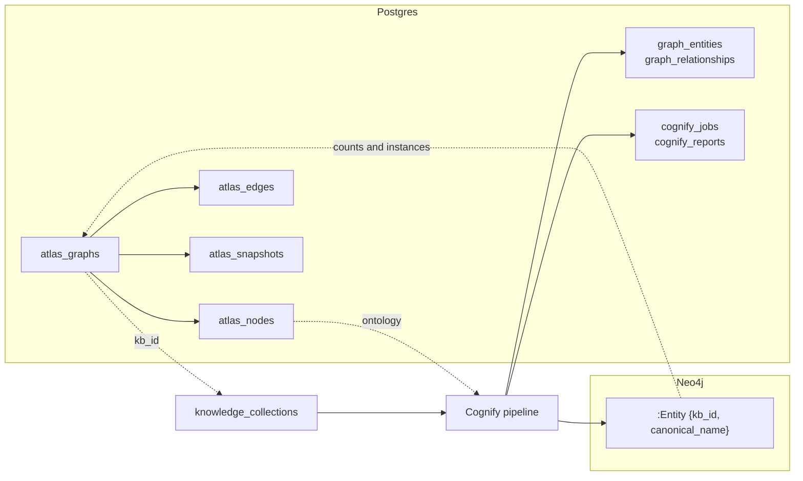

# Atlas + Knowledge Engine

Atlas and Cognify together make the **enterprise context graph**.

- **Atlas** is the governed schema. Graphs, typed nodes and edges, snapshots and bindings to live data, all in Postgres tables. It ships five starter ontologies (FIBO Core, FIX Protocol, EMIR Reporting, ISDA Master Agreement, ETRM EOD Workflow).
- **Knowledge Engine (Cognify)** turns the documents of a knowledge collection into entities in Neo4j. Each node is an `:Entity` keyed by `kb_id` and `canonical_name`. Hybrid search reads that graph next to the vector store.

An Atlas graph bound to a collection (`atlas_graphs.kb_id`) governs what Cognify extracts from it. Concept nodes are the entity types, edges between concepts are the relationship types, and each entity records its concept in `atlas_concept_id`. Atlas shows the entity counts per concept and browses the real instances in Neo4j. Atlas never writes entities and Cognify never writes Atlas rows, the only thing crossing is the ontology going one way and the counts and instances coming back.

## The enterprise context graph

| Question | Where the answer lives |
|---|---|
| What kinds of things exist and how may they relate | Atlas concepts and edges, in Postgres, versioned with snapshots |
| What real things exist and how do they relate | `:Entity` nodes and typed relationships in Neo4j, mirrored to `graph_entities` and `graph_relationships` |
| Which concept is this entity an instance of | `atlas_concept_id` on the node and the mirror row |
| Which documents say so | `source_doc_ids` on the node and the relationship, which is also what graph ACLs read |

How to use it, in order.

1. Build or import an ontology in Atlas. Only `concept` nodes and the edges between them count.
2. Bind a knowledge collection with **Bind KB**. The graph now governs that collection, set `settings.governs_extraction` to `false` to stop that. When several graphs are bound, one with `governs_extraction` set to `true` wins, then the most recently updated.
3. Run Cognify on the collection. It sends the concepts to the model, then drops proposals that fit no concept or break an edge's domain and range, and counts them as `off_ontology_dropped`. Set `settings.ontology_mode` to `guided` to keep them unmapped instead.
4. Read the result on the Atlas page, in the inspector with nothing selected, or from the routes below. Select a concept to page through its real entities.

After changing the ontology, run Cognify with `force` to retype what is already extracted. A normal run only pays for new chunks.

A graph in another tenant can never govern a collection, the ontology query checks both tenants match, and binding checks the caller can read the collection.

Counts on the context route are totals for the collection, so they include entities from documents the caller may not read. Browsing and querying apply the document ACL.

## Atlas

The canvas is the **Atlas** page at `/atlas`.

### Data model

| Table | Holds |
|---|---|
| `atlas_graphs` | One row per graph. Owner, name, optional `kb_id` binding, `version`, node and edge counts, `settings` |
| `atlas_nodes` | Label, `kind` (`concept`, `instance`, `document` or `property`), description, `properties` (JSONB), canvas position, optional `document_id`, `source`, `confidence`, tags, and the bi-temporal columns |
| `atlas_edges` | `from_node_id`, `to_node_id`, label, `cardinality_from` and `cardinality_to`, `inverse_edge_id`, `is_directed`, `properties`, `source`, `confidence`, and the bi-temporal columns |
| `atlas_snapshots` | One row per saved version, automatic or by hand (`auto`), for the time slider and restore. Older rows hold the whole graph in `payload`, new ones hold `format: diff` and counts |
| `atlas_snapshot_rows` | The changed rows of each snapshot, one row per node or edge and version with a `deleted` flag. A row's state at a version is its newest entry at or before that version |

Bi-temporal columns on nodes and edges:

| Column | Meaning |
|---|---|
| `valid_from` | When the fact became true in the world |
| `valid_to` | When it stopped being true. `NULL` means still current |
| `recorded_at` | When the platform learned it |
| `source_anchors` | JSONB list of supporting citations |

Models live in [`packages/db/models/atlas.py`](../../packages/db/models/atlas.py). Column detail is in [04-data-model/03-knowledge](../04-data-model/03-knowledge.md).

### REST

All under `/api/atlas` in [`routers/atlas.py`](../../apps/api/app/routers/atlas.py):

| Route | Does |
|---|---|
| `GET/POST /graphs`, `GET/PATCH/DELETE /graphs/{id}` | Graph CRUD. `GET` returns at most `node_limit` nodes (default and maximum 5000) with the edges among them, plus `truncated` and `next_cursor` to page with `after`. `node_limit=0` returns only the meta |
| `GET /graphs/{id}/overview` | The most connected nodes, up to 1000, where to start on a big graph |
| `GET /graphs/{id}/viewport` | Nodes inside a canvas rectangle, an even sample when more than `limit` are there, with `in_view` |
| `GET /graphs/{id}/neighbourhood` | A node and its neighbours up to 3 hops, `fanout` edges per node, with `truncated` and the node's `degree` |
| `GET /graphs/{id}/search` | Nodes whose label contains `q`, keyset paged |
| `GET /graphs/{id}/context` | The context graph summary, the binding, entity counts per concept, mapped and unmapped totals, the latest job |
| `GET /graphs/{id}/entities`, `/entities/neighbourhood`, `POST /entities/query` | Real instances from Neo4j, by concept, type or name, one hop around an entity, or a typed relationship between concepts |
| `POST /graphs/{id}/nodes`, `PATCH/DELETE /graphs/{id}/nodes/{node_id}` | Node CRUD |
| `POST /graphs/{id}/edges`, `PATCH/DELETE /graphs/{id}/edges/{edge_id}` | Edge CRUD |
| `POST /graphs/{id}/parse-nl` | A sentence becomes a list of graph ops |
| `POST /graphs/{id}/extract` | A dropped document, image, audio, video or text file becomes proposed nodes and edges |
| `POST /graphs/{id}/apply` | Applies the ops from `parse-nl` or `extract` |
| `GET /graphs/{id}/suggestions` | Likely duplicates, missing inverse edges and orphan nodes |
| `GET/POST /graphs/{id}/snapshots`, `POST /graphs/{id}/snapshots/{snapshot_id}/restore` | List and save snapshots, restore one |
| `GET /graphs/{id}/export?format=json-ld` | JSON-LD (the default) or plain JSON with `format=json` |
| `POST /graphs/{id}/bind-kb`, `/sync-kb`, `/persist-to-kb` | Bind a collection, project its documents onto the canvas as document nodes, write a dropped file into the bound collection. Over 500 missing documents, `sync-kb` answers `queued` and works in batches in the background, `GET /sync-kb` reports progress |
| `POST /graphs/{id}/query` | Matches a small graph pattern |
| `PATCH /graphs/{id}/nodes/{node_id}/binding`, `GET /graphs/{id}/nodes/{node_id}/instances` | Binds a node to a live data source and lists its instances |
| `GET /starters`, `POST /graphs/{id}/import-starter` | The starter ontologies |
| `POST /graphs/{id}/relayout` | Recomputes the canvas layout |

### Agent tools

The six tools in [`engine/tools/atlas_tools.py`](../../apps/agent-runtime/engine/tools/atlas_tools.py) read the Atlas tables over their own small asyncpg pool on `DATABASE_URL`. They only see graphs in the run's tenant, and only the graphs in `model_config.atlas_graphs` when the agent sets that list. With no `graph_id` they use the most recently updated graph they can see.

| Tool | Does |
|---|---|
| `atlas_describe` | Counts per kind, top edge labels and the most connected concepts of a graph |
| `atlas_query` | Finds nodes by label substring and optional `kind` |
| `atlas_traverse` | One hop out from a node, in and out edges with the nodes on the other end |
| `atlas_search_grounded` | Finds concept nodes whose label contains `near_label`, then returns the document nodes linked to them and their collection document ids |
| `atlas_instances` | The real entities behind a concept in Neo4j, by concept, name, neighbourhood or relationship, with the agent's document ACL applied |
| `atlas_as_of` | The graph as it stood at a past moment (see below) |

All six return structured JSON, not paragraphs. Their input schemas are in [02-runtime/02-tools](../02-runtime/02-tools.md).

`atlas_as_of` takes `graph_id`, `as_of`, `label_like`, `kind` and `limit`. If the graph has not changed since `as_of`, it reads the live rows and honours `valid_from` and `valid_to`. Otherwise it reads the newest `atlas_snapshots` row saved at or before `as_of`, and says so when there is none.

### Large graphs

Nothing in the API or the page loads a whole big graph.

| Limit | Value | What happens past it |
|---|---|---|
| Full canvas | 1000 nodes | The page opens on the busiest node and its neighbours, says how much is on screen, and loads more when you pan, search or double-click a node |
| Nodes held in the browser | 1200 | The oldest loaded nodes that are not selected fall out |
| `GET /graphs/{id}` | 5000 nodes a page | `truncated` and `next_cursor` |
| Window routes | 1000 nodes | `truncated` |
| Reads | 8 seconds | 422 asking for a narrower query, the pool stays free |

Single row edits update the version and counts in one statement. Label search uses a trigram index on `lower(label)`, created at API start and by the migration when the role may create `pg_trgm`. Without it search still works by scanning, within the time limit.

Measured on 100,000 nodes and 200,000 edges in Postgres 16, median of real requests through the router.

| Call | Before | After |
|---|---|---|
| Open the graph | 4.8 s, 114 MB | overview 98 ms, 78 KB |
| Create a node | 9.6 s | 10 ms |
| Change a node | 2.9 s | 6 ms |
| Delete a node | 4.0 s | 16 ms |
| Snapshot after one edit | 8.5 s, a whole copy | 443 ms, one row |
| Pattern query | 3.2 s | 8 ms |
| Viewport | none | 12 ms |
| One hop neighbourhood | none | 5 ms |
| Search | none | 7 ms |

### Snapshots

The first snapshot of a graph copies its rows into `atlas_snapshot_rows`, in the background once the graph has more than 2000 nodes. Each later one adds only the rows changed since, and a tombstone for each row removed. Restore rebuilds the state at that version in SQL and writes only rows that differ, keeping their ids. Automatic snapshots are kept to the newest `ATLAS_SNAPSHOT_KEEP_AUTO` (default 50) and row versions no snapshot can reach are removed. Labelled snapshots stay. Snapshots from before this format still restore from their `payload`.

### Adding a starter ontology

Starters are the `ATLAS_STARTERS` dict in [`routers/atlas.py`](../../apps/api/app/routers/atlas.py), keyed by id (`fibo-core`, `fix`, `emir`, `isda`, `etrm-eod`). An entry has a `name`, a `description` and a list of `ops` (`add_node` and `add_edge`, the same ops `/apply` takes). `GET /api/atlas/starters` lists it with its node and edge counts, and the canvas import flow picks it up with no UI change.

## Knowledge Engine (Cognify)

### Pipeline

`POST /api/knowledge-engines/{kb_id}/cognify` creates a `cognify_jobs` row and sends [`cognify_task.py`](../../apps/worker/worker/tasks/cognify_task.py) to the `cognify` queue. Superseded versions are left out. A second run on a collection with a live job answers 409. With `dry_run` it spends nothing and returns the chunk count and an estimate.

| Request field | Default | What it does |
|---|---|---|
| `model` | `COGNIFY_DEFAULT_MODEL` | The extraction model, Haiku unless changed |
| `max_cost_usd` | `COGNIFY_JOB_BUDGET_USD`, 50 | The job stops here with status `stopped` |
| `force` | false | Reprocess chunks already in the ledger and recount mentions |
| `doc_ids` | none | Only these documents, ledger skipping still applies |
| `selection` | `all` | `sample` takes a stable share of chunks, `salient` the richest in names and numbers |
| `sample_rate` | 1.0 | The share for `sample` and `salient` |
| `max_chunks_per_doc` | none | At most this many per document, the richest ones |
| `max_parallel_chunks` | 4 | Model calls at once per document task |
| `requests_per_minute`, `tokens_per_minute` | 300, 400000 | The token bucket every Cognify worker shares for this provider, in Redis. If Redis does not answer each process limits itself |
| `llm_resolution` | true | Ask the model about close names at the end, within what is left of the budget |

1. **Plan.** `run_cognify_job` checks the daily budget and Neo4j, creates the constraint and indexes, stamps older nodes with their search token and tenant, and records the documents in `cognify_job_documents`. Documents with `cognified_at` set are left out unless `force` or `doc_ids` asks for them. With nothing to do the job ends `complete` with `stop_reason` `up_to_date`.
2. **One task per document.** `run_cognify_document` runs up to `max_parallel_docs` at a time per job, each finished one starts the next. It reads the indexed text from `chunks` when it is there, because OCR is neither free nor stable, and the file otherwise.
3. **Ontology.** The bound Atlas graph, then the project's active ontology schema. Proposals are checked as well as guided.
4. **Batches.** Chunks with a done row in `cognify_chunks` are skipped. Every `COGNIFY_GRAPH_BATCH_CHUNKS` (default 20) chunks the task checks the budget and the stop flag, calls the model, saves the output to `cognify_chunks`, resolves against the stored graph, writes to Neo4j, then mirrors to Postgres in the transaction that marks the chunks done and adds to the job counters.
5. **Time slice.** After `COGNIFY_TASK_TIME_SLICE_S` (default 1200) the task requeues the document and ends. The next task carries on from the ledger.
6. **Failures.** A chunk whose model call fails after backoff is counted in `chunks_failed` and retried by the next run. A row Neo4j rejects is split out of its batch and counted. Neo4j going away after retries stops the document, which retries, and what was extracted is replayed without paying again. A batch replayed after a crash does not count its mentions twice.
7. **Finish.** `finalize_cognify_job` runs KB wide resolution in [`kb_resolution.py`](../../apps/agent-runtime/engine/knowledge/kb_resolution.py), refreshes `entity_count`, writes `cognify_reports` and sets `complete`, `stopped` or `failed`. `documents.cognified_at` is set per document when every chunk of it is done, and not after a sample.

`POST /{kb_id}/cognify/{job_id}/stop` stops a job after its current batches. `GET /{kb_id}/cognify-jobs` shows chunks done, skipped and failed, entities and relationships written and failed, spend and budget. A job is called stalled after 6 hours with no heartbeat, not 6 hours after it began.

`DELETE /{kb_id}/graph` queues the Neo4j delete, clears the mirror and the ledger, so the next run starts over. Deleting a collection removes its graph too.

### Entity resolution at scale

Measured on synthetic company names with planted duplicates, one process, no database. The old scan is the `SequenceMatcher` loop this replaced, which also blocked the event loop.

| Names | Old scan | New | Comparisons per name | Typo recall | Case and punctuation recall | Word order recall | Peak memory |
|---|---|---|---|---|---|---|---|
| 10,000 | 142 s | 0.4 s | 4.5 | 97.0% | 100% | 100% | 40 MB |
| 100,000 | about 4 hours, extrapolated | 6.5 s | 42 | 98.5% | 100% | 100% | 98 MB |
| 1,000,000 | about 16 days, extrapolated | 94 s | 90 | 98.1% | 100% | 100% | 218 MB, 174 MB of temporary disk |

Through real Neo4j at 1,000,000 entities and 200,000 relationships, writes ran at 11,000 entities and 14,000 relationships a second through the batched writer, and retrieval took 12 to 150 ms once the KB's search tokens were stamped.

### Reading the graph

| Reader | Uses |
|---|---|
| `hybrid_search.py` | Vector hits plus a graph expansion over `:Entity` nodes for the same `kb_id`, weighted by `graph_weight` (default 0.4) and `graph_depth` (default 2) |
| `knowledge_search` tool | Hybrid search for an agent with a granted collection |
| `graph_explorer` tool | Looks up an entity and its neighbours in Neo4j |
| `GET /api/knowledge-engines/{kb_id}/graph` | The graph for the UI |
| `memify_pipeline.py` | Adjusts the graph from usage signals and retrieval feedback |

Connection settings are `NEO4J_URI`, `NEO4J_USER`, `NEO4J_PASSWORD` and `NEO4J_DATABASE`, read in [`engine/knowledge/neo4j_client.py`](../../apps/agent-runtime/engine/knowledge/neo4j_client.py). `graph_writer.delete_kb_graph` removes a collection's entities in small transactions.

### Query limits and isolation

Every read filters by `kb_id` from its first pattern and by `tenant_id` when the caller has one. A test parses every Cypher string in the platform and fails on a node pattern with no knowledge base filter. Community edition has one user database and no role based access, so these filters are the isolation, there is no second line in the database.

| Limit | Value |
|---|---|
| Any read query | `NEO4J_QUERY_TIMEOUT_S`, 15 seconds, enforced by the server |
| A whole graph search | `GRAPH_SEARCH_DEADLINE_S`, 20 seconds, then partial results and a note in `degraded` |
| Any write transaction | `NEO4J_WRITE_TIMEOUT_S`, 120 seconds |
| Names matched per search | 25 |
| Relationships read per node, before sorting | 1000 |
| Relationships kept per node | 25 |
| Frontier per hop | 50 nodes |
| Traversal results | 30 |

Traversal walks one hop at a time, so the limits bound the work and not only the answer. Names are found through the unique index on `(kb_id, canonical_name)`, aliases and partial names through the `entity_names` fulltext index, which holds the KB as a token so scoring only sees that KB. A graph that fails or times out leaves the vector results standing.

## v2.0 knowledge features

| Feature | State in code |
|---|---|
| Document versioning, `POST /api/knowledge/{kb}/documents/{doc}/replace` | Adds a new `documents` row one `version_number` higher and marks the old row `is_current = false` with `superseded_by` set. Only the current head can be replaced. The call does not queue the new file for processing, and search and Cognify do not read `is_current`. See [document-versioning](../document-versioning.md) |
| Document grants, `document_grants(document_id, subject_type, subject_id, permission, expires_at)` | A document with no live grants is visible to everyone who can read the collection. The first grant restricts it to its grantees (users or agents), tenant admins, the collection creator and holders of WRITE or ADMIN on the collection. Search drops restricted documents before ranking and the document list hides them. Only collection editors add or remove grants. Rule in [`engine/knowledge/document_acl.py`](../../apps/agent-runtime/engine/knowledge/document_acl.py) |
| Cognify config, `GET/PUT /api/knowledge/cognify-config` | `auto_accept_threshold`, `conflict_action`, `max_parallel_docs`, `daily_budget_usd` per tenant. The pipeline enforces all four. Proposals below the threshold stay out of the graph and are counted in the job report. Edited on **Settings > Cognify config** (`/settings/cognify`) |
| Cognify conflicts, `GET /api/knowledge/cognify-conflicts`, `POST /api/knowledge/cognify-conflicts/{id}/resolve` | A row is written when sources disagree on an entity's type. With `conflict_action` `flag` it stays `open` until someone resolves it, which writes the chosen type to the graph. `split`, `higher_conf_wins` and `lower_conf_wins` record it already settled |
| Re-embed, `GET/POST /api/knowledge/{kb}/reembed` | GET returns the model, the allowed models and job progress. POST is admin only. With `dry_run: true` it estimates, without it queues `kb_reembed`, which re-reads and re-chunks every document, then switches the collection in one step. Nothing changes on failure |
| GDPR purge, `POST /api/gdpr/users/{id}/purge`, `GET /api/gdpr/users/{id}/receipts` | [`services/gdpr_purge.py`](../../apps/api/app/services/gdpr_purge.py) covers postgres, pinecone, neo4j, blob and trajectory and writes a `gdpr_purge_log` row per store with `affected_count`. The neo4j step deletes Cognify entities naming the person and their Postgres graph rows. UI at `/settings/gdpr`. See [15-v2-knowledge-enterprise](../02-runtime/15-v2-knowledge-enterprise.md#gdpr-cascade) |
| At-rest encryption | AES-256-GCM in [`core/crypto.py`](../../apps/api/app/core/crypto.py) under `ABENIX_DATA_KEY_KEK_BASE64`, with per-tenant keys derived by HMAC. It covers tool credentials, the tenant Slack webhook URL, the approval webhook secret, MCP secrets and held moderation text. Persona items and agent memories are not encrypted yet. Without a KEK values are stored as entered. See [06-encryption-setup](../08-howto/06-encryption-setup.md) |
| Extractors, [`engine/knowledge/extractors/`](../../apps/agent-runtime/engine/knowledge/extractors/) | `text_pdf`, `ocr`, `vision_pdf` and `office` behind `dispatch.extract_document`, called by the worker on ingest. It records `extraction_method` and `extraction_quality` and chunks carry page numbers. Pages with under 50 characters go to OCR. `KB_OCR_MODE` is `auto`, `tesseract`, `vision` or `off`, and `auto` prefers Tesseract, which the worker image ships, then a vision model when a key is set. `KB_OCR_MAX_PAGES` caps a document at 2000 pages and `KB_OCR_LANGUAGES` picks Tesseract languages |
| Reranker, [`engine/knowledge/reranker.py`](../../apps/agent-runtime/engine/knowledge/reranker.py) | Wired into search. Cohere when `COHERE_API_KEY` is set, the Haiku scorer only with `RERANKER_PROVIDER=llm`. Hits carry `metadata.citation` |
| Pinecone vacuum, [`worker/tasks/pinecone_vacuum.py`](../../apps/worker/worker/tasks/pinecone_vacuum.py) | Queued daily at 02:30 UTC by the API scheduler on the `documents` queue. Deletes namespaces of deleted collections, vectors past a document's chunk count and persona vectors of deleted items |

## Where to look in the code

- Atlas API: [`apps/api/app/routers/atlas.py`](../../apps/api/app/routers/atlas.py)
- Atlas tools: [`atlas_tools.py`](../../apps/agent-runtime/engine/tools/atlas_tools.py)
- Cognify API: [`knowledge_engine.py`](../../apps/api/app/routers/knowledge_engine.py), v2 routes in [`knowledge_v2.py`](../../apps/api/app/routers/knowledge_v2.py), grants in [`document_grants.py`](../../apps/api/app/routers/document_grants.py)
- Cognify pipeline and Neo4j: [`apps/agent-runtime/engine/knowledge/`](../../apps/agent-runtime/engine/knowledge/)
- Worker tasks: [`apps/worker/worker/tasks/`](../../apps/worker/worker/tasks/)
- Models: [`atlas.py`](../../packages/db/models/atlas.py), [`knowledge_engine.py`](../../packages/db/models/knowledge_engine.py), [`knowledge_base.py`](../../packages/db/models/knowledge_base.py), [`cognify_config.py`](../../packages/db/models/cognify_config.py), [`document_grant.py`](../../packages/db/models/document_grant.py), [`gdpr_purge_log.py`](../../packages/db/models/gdpr_purge_log.py)
- UI: [`/atlas`](../../apps/web/src/app/(app)/atlas/page.tsx), [`/settings/cognify`](../../apps/web/src/app/(app)/settings/cognify/page.tsx), [`/settings/gdpr`](../../apps/web/src/app/(app)/settings/gdpr/page.tsx)

## Related

- [02-runtime/02-tools](../02-runtime/02-tools.md), the atlas and knowledge tools with their schemas
- [02-runtime/15-v2-knowledge-enterprise](../02-runtime/15-v2-knowledge-enterprise.md)
- [04-data-model/03-knowledge](../04-data-model/03-knowledge.md)
- [document-versioning](../document-versioning.md)
