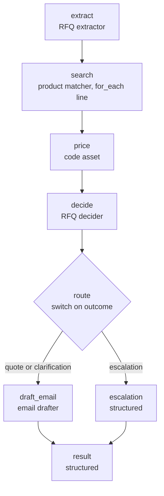

# QuoteIQ — RFQ quoting for a wire and cable maker

> Reads request-for-quotation emails for a fluoropolymer wire and cable
> manufacturer, finds each line's product in a mock ERP, and drafts a quote or a
> clarification for a person to review, or escalates the RFQ to staff.
> Seven nodes, four agents and one code asset.
> Ports 3008 (web) and 8008 (api).

---

## Layout

```
quoteiq/
  api/          FastAPI on :8008. app/core (store, runs, reviews, results),
                app/routers (emails, reviews, health), tests/, sdk/
  web/          Next.js on :3008. Pages: / (inbox), /emails/[id]
  code-assets/  erp-query: the mock ERP and its 127-product catalogue
  scripts/      generate_products.py (the catalogue), verify_seed_data.py, evaluate_pipeline.py
  test-data/    emails/ (seven example RFQs), expected-outcomes.json
  k8s/          quoteiq.yaml (quoteiq-api ClusterIP, quoteiq-web NodePort 30308)
  start.sh      local dev launcher
```

The agents and the pipeline are seeded from `packages/db/seeds/agents/qq_*.yaml`. The API key is `QUOTEIQ_ABENIX_API_KEY`. Step-by-step setup is in [`quoteiq/README.md`](../../quoteiq/README.md).

---

## Why this one exists

The showcase is product search. Customers write RFQ lines loosely, and the
three example styles need three different readings:

| The customer writes | What has to happen |
|---|---|
| `M22759/16-22-9` | Read the slash sheet, the AWG size and the MIL-STD-681 colour code from the part number |
| `600V 7/0.16 OD 1.1 BLK, Wht, Red, Grn` | Convert metric stranding to AWG, expand the colours into four lines, keep the OD as a filter |
| A plain-language high-voltage spec | Turn ratings into minimums (6 kV means 6 kV or more), and choose the filters the wording supports |

Reading is the model's job. Searching and pricing are not. Each line goes to
an agent that turns the words into a structured ERP query and calls a code
asset that filters the catalogue and looks up products. The agent only names
the product it matched. A step with no model then takes every matched line's
product record and prices from the same code asset, so nothing on a quote
comes from the model, even if the model misreports what the ERP said.

Each line is searched in its own step, a `for_each` over the lines, so the run
view shows every line's search and its ERP calls separately. One agent looping
over the lines would have been one opaque step.

No email reaches a customer without a person approving it, and that approval
is an Abenix approval, not a button inside the app.

---

## The pipeline

`quoteiq-rfq` — eight nodes.



| Node | Agent | What it decides |
|---|---|---|
| `extract` | `quoteiq-rfq-extractor` | The sender, facts that apply to every line, and the RFQ lines: colour lists expanded, duplicate rows merged, units in metres |
| `search` | `quoteiq-product-matcher`, once per line | What the line means, the filters it sent, the line's outcome, and for a match the product |
| `price` | none: the `quoteiq-erp-query` code asset | Every matched line's product record and prices, from the ERP, for the quantities in the email |
| `decide` | `quoteiq-rfq-decider` | Quote, clarification or escalation for the whole RFQ, and the brief for the email |
| `route` | `__switch__` | Which branch runs |
| `draft_email` | `quoteiq-email-drafter` | The reply: recipient, subject, greeting, body, closing |
| `escalation` | structured | The items for staff, with SKUs |
| `result` | structured | What the app reads |

Every agent answers with one line of strict JSON and uses `claude-sonnet-4-5-20250929`.

### Line outcomes

| Outcome | When |
|---|---|
| Matched | Exactly one product fits, and its record is consistent |
| Needs clarification | Several products fit and differ on something the customer didn't state |
| Not in catalogue | No product fits. The nearest products go to staff |
| ERP record inconsistent | The product that fits contradicts itself, for example its colour field against its name |

### RFQ outcome

The RFQ is held unless every line matched: no partial quotes. Any line not in
the catalogue or with an inconsistent record escalates the RFQ. Otherwise, if
any line needs clarification, one clarification email covers every such line.
Otherwise the RFQ is quoted. No quantity means the minimum order
quantity, and a quantity below it is raised to it, with a note.

---

## The code asset

`quoteiq-erp-query` holds the catalogue as a CSV beside a small Python program.
Agents call it through the `code_asset` tool with an operation and its
arguments, and the pipeline calls it once more after the search.

| Operation | Returns |
|---|---|
| `search_products` | The count and full records for any combination of filters: part number (exact or a prefix), family, AWG, stranding, cores, conductor, plating, insulation, jacket, colour code, OD with a tolerance, minimum voltage and test voltage, temperature range, corona resistance, free text |
| `get_product` | One full record by SKU |
| `get_price` | For one or more quantities: the quoted quantity, whether the MoQ was applied, the quantity-break discount, net unit price and line total, plus lead time |
| `list_values` | The values a field takes, so the agent uses the ERP's terms |
| `price_lines` | Called by the pipeline's `price` step, not by an agent: the line results with each matched line's product record and prices from the ERP. A matched SKU the ERP doesn't hold fails the step |

The catalogue has 127 synthetic products from a generator with a fixed seed:
hook-up, airframe (M22759/16, dimensions from the slash sheet), high-voltage,
multi-core and data cable, and tape. Near-duplicates that differ in one
attribute force the search to use every stated attribute, and five records are
deliberately inconsistent. `scripts/verify_seed_data.py` checks the catalogue
and plays every example line against the asset's own search.

---

## Every draft is an Abenix approval

After a run drafts an email, the app raises an approval linked to that run, with
the email (and for a quote, the priced lines) as its payload and the longest
expiry Abenix allows, 7 days. The reviewer's three choices map onto the
approval's three decisions:

| Reviewer chooses | Approval decision | What happens |
|---|---|---|
| Send | Approve | The email is recorded as sent. Nothing is mailed, as this is an example |
| Ask the customer | Return for changes, with a note | The app runs the email drafter on the note and the RFQ's line results, with the SKUs taken out, and the new clarification comes back for review |
| Escalate | Deny, with a note | Nothing is sent. Staff take the RFQ over |

A decision made on Abenix's Approvals page counts the same: the API checks open
approvals every 10 seconds. The reviewer can edit a draft before sending. The
approval's payload keeps the AI draft, and the app keeps both texts. An edit
can't name a SKU, and a draft can't be edited while its decision is being
signed, because the decision has already chosen which text goes out. A review
that expires can be raised again.

The app has no sign-in. It acts as one configured staff user (`QQ_STAFF_NAME`),
who is the acting user on every run (`subject_type` `quoteiq`) and signs every
email. Abenix records the API key's account as an approval's signer, so the
reviewer's name goes into the reason: `Reviewed by Priya Shah: <note>`.

---

## Talking to Abenix

Through the SDK, always. The pipeline is started with `wait="submitted"`, so
the email holds its run id at once and the run can be opened in Abenix while it
goes. The app then follows the run's event stream (`/api/executions/{id}/stream`,
through `sdk.http`) for the step tracker and the count of lines searched, and
checks the run itself on every heartbeat, because a run that ends between the
stream's replay and its follow would otherwise leave it waiting.

The app calls a run a System error when it failed, timed out or can't be read:
a missing line, an unknown outcome, a quote with no email, or an email that
names a SKU. SKUs are for staff and never reach a customer. Business outcomes
are the pipeline's. A check of the run that fails for a moment, because the
network or Abenix is briefly unavailable, is tried again until the run's
deadline. Retry runs the failed step again, the pipeline or the redraft.

The model's free-text fields don't always come back in the same shape (what
candidates differ on as a map or a list, a record problem as text or an
object), so the API reads them into one shape before the web app sees them.

With `DATABASE_URL` set, the inbox is kept in the `qq_emails` table. A run
still going when the API stopped is picked up again on start.

---

## Screens

| Route | What it shows |
|---|---|
| `/` | Totals, one card per status with its awaiting-review count, and the inbox. **Process next RFQ email** sends the oldest waiting email to the pipeline, and **Process selected** sends the ticked ones. Several can run side by side |
| `/emails/{id}` | The email as received, with **Process** while it waits. The step tracker. Each line with outcome, product, quantities, prices and lead time, and **How it was matched**. The draft with Send, Ask the customer and Escalate, or the internal escalation panel. Earlier drafts and the history |

<p align="center">
  
  <br/><em>An email page — each line matched to a product, the minimum order quantity applied where the request fell short, and the quote email waiting for review</em>
</p>

<p align="center">
  
  <br/><em>The inbox, with a card per status and the reviews still waiting</em>
</p>

---

## The example emails

| Email | What it tests | Expected |
|---|---|---|
| 01 | Shorthand, one line per colour, a twisted-pair cable with no quantity | Quote, 13 lines |
| 02 | A JSS part number, no quantity | Quote at the minimum order quantity |
| 03 | M22759/16 part numbers | Quote, 8 lines |
| 04 | JSS part numbers below the minimum order quantity | Quote, each line raised to the MoQ with a note |
| 05 | A plain-language high-voltage spec at four quantities | Quote, 2 lines with quantity breaks |
| 06 | A specification with no size or colour | Clarification, offering the sizes and colours on offer |
| 07 | A good line, a broken ERP record, a size not made | Escalated, with the record's SKU and the nearest sizes |

`test-data/expected-outcomes.json` holds each line's expected outcome and each
reply's expected greeting. The emails are reworded from real enquiries, with
invented senders on `.example` domains.

`scripts/evaluate_pipeline.py` runs the emails through the pipeline and scores
every run against those expectations: the status, each line's outcome, the
nearest sizes, the greeting, no SKU in an email, and every matched line's
prices against the code asset's own arithmetic. It also reports each email's
true cost, each line's search included.

---

## Running it

```bash
APPS=quoteiq bash scripts/deploy.sh local      # this app only
bash scripts/seed-standalone-keys.sh quoteiq   # mint its Abenix API key
```

Then open http://localhost:3008 and press **Process next RFQ email**. Locally
without a cluster, `APPS=quoteiq bash scripts/dev-local.sh` does the same.

```bash
npx playwright test e2e/uat_quoteiq.spec.ts
```

The spec skips rather than fails when an LLM provider is rate-limited or its
credential is dead. Anything else fails loudly.

---

## Known limitations

- **Progress during a run.** Abenix publishes each line's search as an event
  with a short preview, and doesn't publish how many lines there are. So the
  page counts lines searched while the run goes, and shows the lines and their
  outcomes when it ends.
- **Run cost.** The cost Abenix reports for a run leaves out the `for_each`
  step's items. Each line's own cost is kept with the line.
- **The signer.** Abenix shows the API key's account as an approval's signer
  and marks the sign-off self-approved, because the same key raised it.

---

## See also

- [00-pattern](00-pattern.md) — the contract every standalone app follows
- [05-pharmavigil](05-pharmavigil.md) — another pipeline with code assets, plus an ML model
- [02-runtime/01-pipelines](../02-runtime/01-pipelines.md) — how the DAG runs, `for_each` and `__switch__` included
- [02-runtime/11-sandboxed-code-execution](../02-runtime/11-sandboxed-code-execution.md) — how a code asset executes
