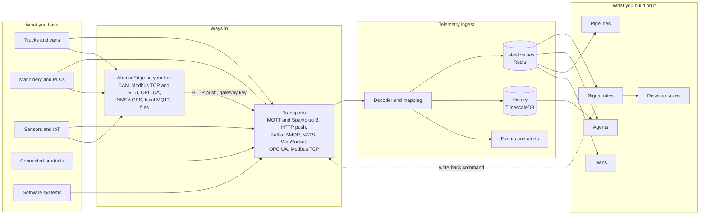
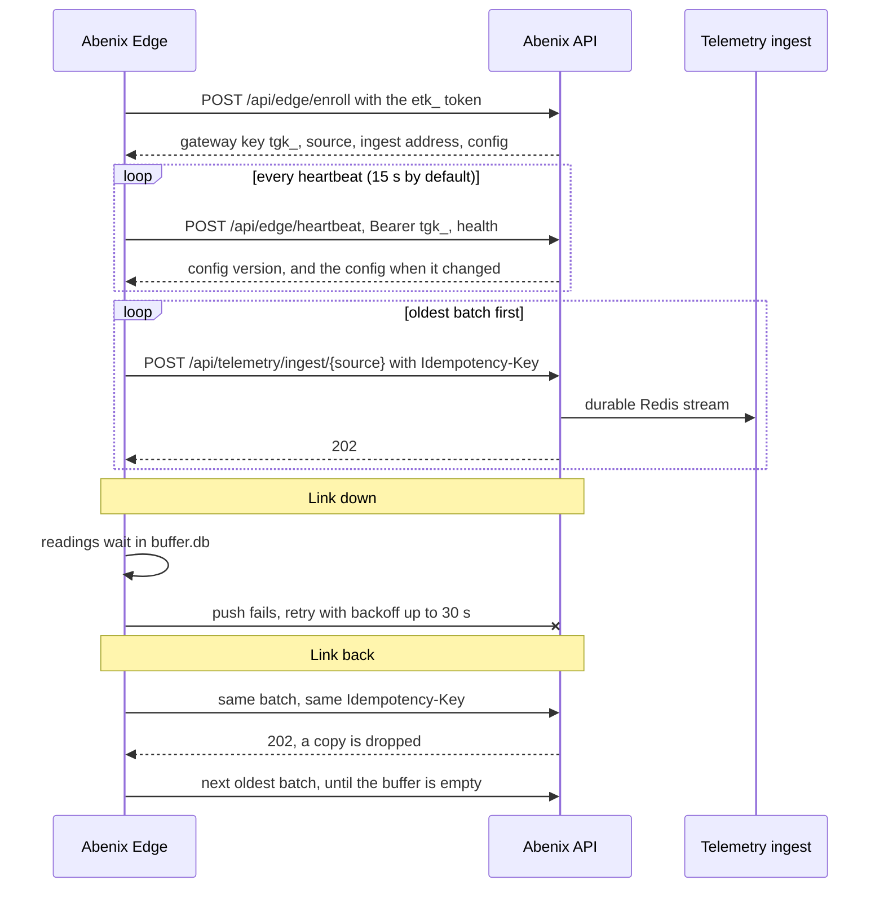

# How to connect your organisation's machines, vehicles and devices

> You have deployed Abenix and want live data from your trucks and vans, machinery, sensors, the products you make and the software you run. This page says which way in fits each one, where it starts in the UI, and the one case where code has to run on your side. Sources, decoders and mappings are covered in detail in [17-telemetry](17-telemetry.md).

---

## How data flows



1. A **source** is one connection to one transport. Abenix reads brokers, topics, queues and OPC UA or Modbus devices itself, and takes HTTP pushes from anything that can call a URL.
2. A **decoder** reads the payload and the source's **mapping** turns it into readings for an asset. Every asset has a key of Group, Asset and Part (`group`, `node`, `device`), such as `fleet / van-042 / engine`.
3. The ingest keeps the latest value of each signal in Redis at once, writes history to TimescaleDB, and raises events and alerts. Rules, agents, pipelines and twins all read from there.

Where things start in the UI:

| You want to | Go to |
|---|---|
| Find the right way in | **Monitor -> Telemetry -> Get started**. It opens by itself while Telemetry is empty |
| Add or change a source by hand | **Telemetry -> Sources -> Add a source** |
| Give each device its own key | The source's **Keys** tab |
| Install a gateway next to the machines | **Edge** (`/edge`) -> **Add an edge gateway** |
| Act when a signal changes | **Telemetry -> Rules** (`/telemetry/rules`) |

Adding sources and gateways needs `telemetry.manage` (admins, or a permission set under **Admin -> Permissions**). Everyone with `telemetry.view` sees the data. Someone without manage rights sees "An admin sets this up under Telemetry, Sources" in the guide.

---

## Trucks and vans

| Path | Fits when | Starts at |
|---|---|---|
| Telematics provider webhook | You already pay a tracking provider. Most fleets do | Get started -> Trucks and vans -> **Your telematics provider already collects the data** |
| Telematics provider stream | The provider publishes to Kafka or MQTT instead of calling a webhook | **Your provider offers a data stream instead** |
| Trackers that send for themselves | Your trackers can post HTTP or publish MQTT | **Your trackers can send MQTT or HTTP themselves** |
| Straight off the vehicle bus | You want J1939 or OBD-II engine data the provider does not pass on | **You want engine data straight off the vehicle bus**, which opens the Edge page |

**Provider webhook or stream.** The guide makes an HTTP push source (or a Kafka source) with the JSON decoder, a sample telematics message and a mapping that files each vehicle under group `fleet` with the asset taken from `$.vehicle_id`. Give the provider the address and token the source shows. Check the mapping against a real message in the mapping editor before you save.

**Trackers.** A tracker that posts HTTP gets its own key from the source's **Keys** tab, one at a time or many from a CSV with a `device_id` column. The key binds the device id, so a tracker can only write as itself.

```bash
curl -s -X POST "$API/api/telemetry/ingest/$SOURCE" \
  -H "Authorization: Bearer tdk_..." -H 'Content-Type: application/json' \
  -d '{"ts": 1760175000000, "lat": 51.5072, "lon": -0.1276, "speed_kmh": 32, "ignition": true}'
# 202 {"accepted": true, ...}
```

Trackers that speak MQTT publish to your broker and Abenix reads it with an MQTT source. The broker's own accounts and ACLs decide which tracker may publish where.

**The vehicle bus.** Nothing in the cloud can read a CAN bus, so this path needs Abenix Edge on an in-vehicle Linux gateway with a CAN interface. It reads J1939 on trucks, buses and machines and OBD-II on cars and vans, and keeps readings on disk while the vehicle is out of coverage. Add a GPS collector on the same gateway for position. See [Abenix Edge in detail](#abenix-edge-in-detail).

---

## Machinery and PLCs

| Path | Fits when | Starts at |
|---|---|---|
| OPC UA, direct | Abenix can reach the PLC or OPC UA server on the network | Get started -> Machinery and PLCs -> **OPC UA, straight from the server** |
| Modbus TCP, direct | Meters, drives and simpler controllers Abenix can reach | **Modbus TCP, read every few seconds** |
| Sparkplug B | You already run SCADA or an MQTT stack with Sparkplug B gateways | **You already run SCADA or an MQTT stack** |
| Abenix Edge on site | The machines sit on a closed site network, use serial Modbus RTU or a CAN bus | **The machines are on a closed site network**, which opens the Edge page |

- **OPC UA** subscribes to the nodes you pick, so values arrive as they change. Status codes become quality.
- **Modbus TCP** polls a register map with type, scale, unit, byte order and word order per register.
- **Sparkplug B** is an MQTT source with the `sparkplug_b` decoder on `spBv1.0/#`. Machines and their parts appear by themselves from their birth messages, and commands go back as `DCMD` or `NCMD`.
- **Abenix Edge on site** reads OPC UA, Modbus TCP, Modbus RTU over RS-485 and CAN on the site network, and sends everything out over one HTTPS connection. Nothing has to be opened inbound.

---

## Sensors and IoT

| Path | Fits when | Starts at |
|---|---|---|
| ChirpStack | Your LoRaWAN network server is ChirpStack | Get started -> Sensors and IoT -> **LoRaWAN through ChirpStack** |
| The Things Stack | Your LoRaWAN network server is The Things Stack | **LoRaWAN through The Things Stack** |
| Zigbee or BLE hub | A hub such as Zigbee2MQTT publishes each sensor on its own topic | **Zigbee or BLE hubs** |
| Cellular sensors | Sensors with their own SIM can post HTTP | **Cellular sensors that post over HTTP** |

- **ChirpStack.** Turn on its MQTT integration and connect an MQTT source to `application/+/device/+/event/up`. The guide's mapping takes the group from the application name, the asset from the device name and the readings from `$.object`.
- **The Things Stack.** Add a webhook integration that points at an HTTP push source. Readings come from `$.uplink_message.decoded_payload`.
- **Zigbee or BLE.** Connect to the hub's broker on `zigbee2mqtt/+`. The second topic segment names the sensor. When the hub broker is on a site network Abenix cannot reach, use the local MQTT collector on Abenix Edge instead.
- **Cellular.** An HTTP push source with a key per sensor, as for trackers above.

---

## Electronics and connected products

| Path | Fits when | Starts at |
|---|---|---|
| The product's cloud | Your products already report to a cloud you run or buy | Get started -> Electronics and connected products -> **The product has its own cloud** |
| Devices post directly | You build the device and can make it post JSON over HTTPS | **The devices post directly** |

Ask the product cloud for a webhook, Kafka or MQTT feed. The guide's mapping makes each unit an asset by its serial number, grouped by model. Devices that post directly each get their own key, which binds the device id.

---

## Software systems

| Path | Fits when |
|---|---|
| Kafka, Redpanda or Event Hubs | Your services already publish to a topic |
| RabbitMQ | Your services publish to an exchange. Abenix reads a queue bound to it |
| NATS or JetStream | Your services publish NATS subjects. JetStream keeps Abenix's place across restarts |
| Webhook or HTTP push | Any system that can call a URL. JSON, NDJSON, CSV and text all work |
| The SDK | The system has no feed at all |

All start at Get started -> **Software systems**. A message can be kept whole as an event, such as `order.created`, while its numbers become signals. For a system with no feed, make an HTTP push source and send from a few lines of code:

```python
forge.telemetry.ingest(source_id, [{"asset": "billing-worker", "queue_depth": 12, "ts": 1760175000000}], token="tdk_...")
```

---

## Where custom code is needed, and why

Almost everything above is set up in the UI. Code has to run on your side in two cases.

| Case | Why | What you run |
|---|---|---|
| The data is on a CAN bus, a serial line (Modbus RTU, NMEA GPS), a PLC on an isolated network, or at a site with poor coverage | Abenix cannot reach it, and the thing cannot reach Abenix by itself | **Abenix Edge**. Abenix ships it as one container and you install it with a command from the Edge page. You write no code |
| A system has no feed, webhook or broker | Nothing sends the data anywhere | A small bridge in or next to that system, with the SDK or plain HTTP to an HTTP push source |

The guide marks both cases in amber with the reason, and hands you the Edge page or the snippet.

---

## Abenix Edge in detail

Abenix Edge is a small Linux container that reads local buses and devices, keeps what it reads on disk, and sends it to Abenix over HTTPS. It is configured from the Edge page and picks up changes on its next heartbeat. It runs on amd64 and arm64.

### Collectors

A gateway runs up to 32 collectors. Each writes to an asset you name (group, asset, part).

| Collector | Reads | Settings |
|---|---|---|
| **Vehicle or machine CAN bus** (`can`) | J1939, OBD-II, or any bus with a DBC file | How the bus is reached, interface, bit rate, protocol, DBC, part names, PGNs to ask for |
| **Modbus TCP or RTU** (`modbus`) | Meters, drives, PLCs, gensets | TCP address and port, or serial port, baud rate, parity, stop bits. Unit id, register map, timeout |
| **OPC UA** (`opcua`) | PLCs and SCADA servers | Endpoint, security policy and mode, user and password, nodes, subscribe or poll |
| **GPS receiver** (`nmea_gps`) | NMEA 0183 position, speed and heading | Serial port or `tcp://` address, baud rate |
| **Local MQTT broker** (`mqtt_bridge`) | Sensors, Zigbee and BLE hubs on a site broker | Broker, topics, user and password, asset templates |
| **File or CSV tail** (`file_tail`) | Logs a machine, logger or program writes | Path or pattern, CSV or JSON lines, time column, read from start |

**CAN.** python-can opens the bus. `socketcan` reads a real interface on the box, such as `can0` from a PEAK or Kvaser USB adapter or a gateway with CAN built in. `socketcand` reads a bus another computer serves over TCP (port 29536 by default), such as an industrial PC on the machine.

- **J1939.** Engine speed, temperatures, fuel, vehicle speed, position, hours and fault codes are read without a DBC. Built in are EEC1, EEC2, ETC2, ET1, EFL/P1, LFE1, CCVS1, HOURS, VD, VDHR, VP, VDS, AMB, VEP1, DD, AT1T1I (DEF level), VI (the VIN, on request) and DM1 (active fault codes and lamps).
- **Parts.** Each ECU becomes a part of the asset, named by its source address. Standard addresses are named for you. Rename with `0=engine, 3=transmission, 11=brakes`.
- **Address claim.** Some values are only sent when asked, such as engine hours (PGN 65253). To ask, Edge claims an address on the bus (249, the service tool address, by default) and moves to a free one if an ECU with a lower NAME wins it.
- **Long messages.** TP.BAM broadcasts and TP.CM RTS/CTS transfers are put back together. Edge answers an RTS sent to it with CTS and EndOfMsgAck.
- **DBC.** Upload the maker's DBC (up to 2 MB) to read their own messages too. It is required when the protocol is "Something else". J1939 "not available" values above a signal's range are skipped.
- **OBD-II.** Mode 01 PIDs in hex, `0C, 0D, 05, 2F, 04` by default. Known PIDs are 04, 05, 0B, 0C, 0D, 0F, 10, 11, 1F, 2F, 31, 42, 46, 5C and 5E. 11-bit ids by default, 29-bit for vehicles that answer on 18DAF1xx.
- **Rate.** A bus sends some frames 100 times a second. The collector keeps the newest value per signal and sends it every interval (1 second by default). The part `bus` carries `Bus/Load_pct` and `Bus/Frames_per_s`.

**Modbus register map.** One register a line: name, table, address, type, then optional scale, unit, word order and byte order. A JSON array also works.

```text
voltage_v, holding, 0, float32, 1, V
energy_kwh, holding, 6, uint32, 0.1, kWh
breaker_closed, coil, 0
```

Tables are `holding`, `input`, `coil` and `discrete`. Types are `int16`, `uint16`, `int32`, `uint32`, `float32`, `int64`, `uint64` and `float64`. Modbus exception codes come back in plain words, such as "that address is not on the device".

**OPC UA nodes.** One node a line: node id, then the signal name and unit you want in Abenix.

```text
ns=2;s=Boiler.Temperature, Boiler/Temp_C, C
ns=2;i=10853, Line/Speed_mps, m/s
```

With security policy Basic256Sha256 Edge makes its own certificate on its data volume. Trust it on the server once.

**Local MQTT.** A JSON message gives one signal per field, nested objects as `a/b/c`. A bare number or word gives one signal named after the last topic segment. A `ts`, `timestamp`, `time` or `t` field sets the time. The asset and part can take topic segments, so `{topic.1}` on `zigbee2mqtt/office-sensor` names the asset `office-sensor`.

**File tail.** Follows files as they grow, every column or field a signal. The offset is kept on disk, so a restart carries on where it stopped. A rotated or truncated file is read again from the start.

### Add an edge gateway

On the Edge page (`/edge`) choose **Add an edge gateway**. The Get started guide links straight here with the right collector picked.

1. **What it collects.** Pick one or more collectors. Each card says what it reads and what the box needs, such as a CAN interface.
2. **Settings.** Name the gateway, then fill in each collector and the asset its readings go to. Every field has an example and is checked as you type. A DBC upload is read and summarised before you save.
3. **Install.** Give the address the gateway uses to reach Abenix, make the command and copy the one for your box. Each carries a fresh enrolment token. The address starts as the `platform.public_api_url` setting (Admin, Settings), then the address your browser reached.
4. **First start.** The page waits, live, until the box enrols. After a minute it lists what to check. A token not used within 24 hours shows as expired. Make a new command.
5. **First data.** Once the box enrols, its source appears under Telemetry -> Sources as "Edge" plus the gateway name. The page shows each collector's status and the first assets as their readings land.
6. **Open in Telemetry.** The last step links to the group in Telemetry. Details on the gateway card lists the assets it writes later on.

The gateway also reports on itself as the asset `edge / <gateway id> / gateway`, with `Edge/BufferDepth`, `Edge/BufferAge_s`, `Edge/Uptime_s` and `Edge/Seq`, every 10 seconds unless you change Gateway readings every. A stale or threshold rule on these warns you when a gateway goes quiet or falls behind.

### Install

The commands are generated for your gateway, with the image this cluster uses, the same one the Edge page lists (`EDGE_COLLECTOR_IMAGE` on the API overrides it, `EDGE_IMAGE_TAG` sets the tag, `latest` by default). They add what the collectors need: host networking for a local CAN interface, `--device` for serial ports and read-only mounts for tailed folders.

**docker run**

```bash
docker run -d \
  --name abenix-edge-truck-12-a1b2 \
  --restart unless-stopped \
  -e ABENIX_URL=https://abenix.example.com \
  -e ABENIX_ENROLL_TOKEN=etk_... \
  -v abenix-edge-truck-12-a1b2-data:/var/lib/abenix-edge \
  --network host \
  <registry>/edge-runtime:latest
```

| Option | Gives you |
|---|---|
| docker run | One line for any Linux box with Docker |
| docker compose | The same as a `compose.yaml`, with a named data volume |
| Kubernetes | A namespace `abenix-edge`, a Secret with the URL and token, and a one-replica StatefulSet with a 2 Gi volume and a readiness probe on `/health`. `hostNetwork: true` when it reads a local CAN interface. Privileged only when serial devices are passed in |
| Linux IPC or Raspberry Pi | A systemd unit `abenix-edge.service` that runs the container, with the URL and token in `/etc/abenix-edge/env` (mode 600). Needs Docker. Use a 64-bit OS on a Pi |

The image is built for amd64 and arm64. To build it yourself:

```bash
docker buildx build --platform linux/amd64,linux/arm64 -t <registry>/abenix/edge-runtime:latest --push apps/edge-runtime
```

**Hardware notes**

- **CAN.** The container needs the host's network to see `can0`: `--network host` in Docker, `hostNetwork` on Kubernetes. Bring the interface up on the host first, at the bus's bit rate. The Edge page prints this line for each channel.

  ```bash
  sudo ip link set can0 up type can bitrate 250000
  ```

- **Serial** (Modbus RTU, NMEA GPS). Pass the port in, such as `--device /dev/ttyUSB0`.
- **File tail.** Mount the folder, such as `-v /data/plc:/data/plc:ro`. The generated command does this for you.

### Store-and-forward

Readings never go straight to the network. They go to disk first and leave when Abenix has room for them.

- **Where.** A SQLite file `buffer.db` on the data volume (`ABENIX_EDGE_DATA`, `/var/lib/abenix-edge`).
- **How.** Readings are staged for a second, then written as compressed chunks, one asset per chunk.
- **Order.** The sender takes the oldest chunk first and gathers more chunks of the same asset into one batch. One batch is in flight at a time, so Abenix sees each asset's readings in order.
- **No copies.** Each batch has an `Idempotency-Key`. Its chunk list is written down before it is sent, so a retry after a timeout or a crash sends the same readings under the same key, and Abenix drops the copy (within 24 hours).
- **Limits.** 1024 MB and 72 hours by default, set per gateway on the Edge page (16 MB to 256 GB, 1 to 720 hours). When full, the oldest readings go first. Readings past the age limit are dropped, sent or not.
- **Too large.** A batch Abenix refuses as too large is split and sent again. A batch Abenix can never read is set aside and counted as rejected.
- **Visible.** Depth, oldest reading age, bytes, and counts of sent, dropped by age, dropped by size and rejected readings all show in health.



### Health on the Edge page

| Shows | Means |
|---|---|
| Status | `waiting` (not enrolled yet), `expired` (token unused for 24 hours), `online`, `offline` (no heartbeat lately), `revoked` |
| Last seen | Time of the last heartbeat |
| Buffer | Depth, age of the oldest reading, size against its limit, and the sent, dropped and rejected counts |
| Uplink | `online`, `offline` (with the reason), `revoked` (key refused, readings kept), `disabled` (the source is turned off in Abenix) |
| Collectors | Each one's status, readings a second, last reading and its error in plain words. CAN adds frames a second, bus load and the ECUs seen |
| Version | Edge version, host name and platform, such as `linux/aarch64` |
| Config pending | You changed something and the gateway has not picked it up yet. It does on its next heartbeat |

---

## Security

| Item | How it works |
|---|---|
| Enrolment token `etk_` | One time, valid 24 hours, kept as a hash. Used up on first enrolment. Making a new install command replaces the old token, and on an enrolled gateway also revokes its key at once |
| Gateway key `tgk_` | Made at enrolment and kept as a hash in Abenix. On the box it sits in `state.json` on the data volume, readable only by its owner. Used for heartbeats and pushes, and only for that gateway's own source |
| Device keys `tdk_` | For devices that post directly. Shown once, kept as a hash, show when last used, can be revoked. Each binds its device id |
| TLS | Use an `https` address for `ABENIX_URL`. Mount your CA and set `ABENIX_CA_FILE` when Abenix uses a private certificate. On the site side use `mqtts://` brokers and an OPC UA security policy |
| Collector secrets | Passwords are encrypted at rest and never shown again. They read as `********` |
| Revoke | Stops the gateway at once. Its key is refused for pushes and heartbeats and it stops its collectors. It keeps its buffer on disk (within the age limit) until it is enrolled again |
| Remove | Forgets the gateway and revokes its key. Its readings stay in Telemetry unless you also remove its source |
| Audit | Create, change, install command, enrolment, revoke and remove are in the audit log as `edge.gateway.*` |

**Gateway environment**

| Variable | Default | Use |
|---|---|---|
| `ABENIX_URL` | none | Where Abenix is, such as `https://abenix.example.com` |
| `ABENIX_ENROLL_TOKEN` | none | The one-time token. Only needed the first time |
| `ABENIX_EDGE_DATA` | `/var/lib/abenix-edge` | The data folder for the buffer, the key and file offsets. Keep it on a volume |
| `ABENIX_CA_FILE` | none | A CA bundle when Abenix uses a private certificate |
| `LOG_LEVEL` | `INFO` | Log detail |
| `PORT` | `8080` | Serves `/health` and `/status` on the box. One port up when the gateway also runs agents |

---

## What to build next

Once data flows, the Telemetry page shows a **What next** panel.

- **Signal rules** at `/telemetry/rules`. Conditions: threshold, out of range, rate of change, stale (no data for N seconds), state equals, geofence enter or exit, and count in a window. Each has hysteresis and a cooldown, and a rule watches one asset, an asset type or a tag. When it fires it can raise an alert, notify a channel, run an agent or pipeline, evaluate a decision table or send a command. The builder shows how often it would have fired over the last hour before you save.
- **Agents** read live values with the `device_state` tool and recent history with `signal_history`.
- **Pipelines** chain steps, such as read the last hour, find outliers and write a shift report.
- **Decision tables** keep limits and what to do about them where people can sign them off. See [09-decisions](09-decisions.md).
- **A twin** as a code asset in Code Runner, fed live values each step.
- **Commands** write back through the source that owns the asset: `POST /api/telemetry/command` with a signal, a value and a reason. They need `telemetry.command`, are rate limited per asset and land in the audit log. See [17-telemetry](17-telemetry.md#step-6-send-a-command).

**Groundwork, the worked example.** [Groundwork](https://github.com/sarkar4777/groundwork) is a construction site twin built this way. Four industrial PCs, `ipc-ex1` (excavator), `ipc-tc1` (tower crane), `ipc-ht1` (haul truck) and `ipc-dz1` (dozer), each run ECUs on a CAN bus speaking J1939. A gateway on each PC publishes Sparkplug B to the site broker, which Abenix reads as the **Site broker** source. The twin drives those four machines from their real bus state and simulates the rest. When a safety hold is needed it goes back as a `DCMD` on `Safety/Hold` and onto the bus as J1939 frames.

---

## Troubleshooting

| Health says | Do this |
|---|---|
| Could not reach Abenix at ... | Check `ABENIX_URL` and that the box can get out to it. Readings wait in the buffer |
| The TLS certificate of ... is not trusted on this box | Mount your CA and set `ABENIX_CA_FILE` |
| This enrolment token is not valid. It was used already or replaced | Make a new install command on the Edge page and run it |
| This enrolment token expired | Make a new install command. Tokens last 24 hours |
| Abenix refused this gateway's key, it was revoked or replaced | Re-enrol from the Edge page. The buffer is sent once it is enrolled again |
| The source for this gateway is turned off in Abenix | Turn the source on under Telemetry -> Sources. Readings wait in the buffer |
| There is no CAN interface called can0 on this box | Run `ip link show`, then `sudo ip link set can0 up type can bitrate 250000` at the bus's rate |
| Not allowed to open can0 | Add `--network host` in Docker, or `hostNetwork` on Kubernetes |
| Could not reach the Modbus device at ... | Check the address and port, and that the device allows Modbus TCP from this box. For RTU check the port, baud rate and `--device` |
| The OPC UA server at ... refused the user name or password | Fix the credentials on the gateway page |
| The OPC UA server at ... refused the security settings | Pick a policy and mode the server offers, and trust the gateway's certificate on the server |
| No file matches ... yet | Check the path, and mount its folder with `-v` |
| Buffer oldest age keeps rising, or dropped counts grow | The link is down or too slow for the data. Check uplink, raise the buffer limits, or lengthen collector intervals |

---

## See also

- [17-telemetry](17-telemetry.md) for sources, decoders, mappings, keys and commands
- [06-deployment/05-edge-runtime](../06-deployment/05-edge-runtime.md) for gateways that run agents
- [13-earned-autonomy](13-earned-autonomy.md) for commands that need a person to agree first
