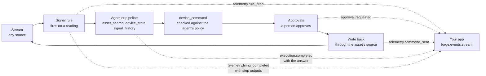

# Close the loop: from a stream to an action in your app

> A reading crosses a line. A rule runs an agent. The agent reads the asset and its history, decides, and proposes a command. A person approves it, the asset takes it, and your own app hears every step. This page builds that from the UI, for any asset, and shows the API and SDK your app uses. Groundwork is one worked example. Connecting the streams is covered in [17-telemetry](17-telemetry.md) and [18-connect-your-organisation](18-connect-your-organisation.md).

---

## The loop



Every arrow is something you set up in the UI. Nothing on this page needs code on the Abenix side.

## 1. Make the agent

1. Open **Monitor -> Telemetry**, pick the asset, and press **Watch this asset with an agent**. Or open **Monitor -> Asset agents**.
2. Pick the asset to watch, and the signals an agent may set if it is to act. Both are optional.
3. Press **Create agent** on a template.

| Template | Tools | Acts on assets | Answers with |
|---|---|---|---|
| Machine health watcher | asset_search, device_state, signal_history, device_command | yes, approval first | `{"healthy", "severity", "finding", "action", "command_sent"}` |
| Fleet dispatcher | asset_search, device_state, device_command | yes, approval first | `{"vehicles", "assignments", "notes"}` |
| Anomaly triage | asset_search, device_state, signal_history | no | `{"real", "severity", "cause", "next_step"}` |
| Shift reporter | asset_search, device_state, signal_history | no | `{"assets", "online", "highlights", "watch"}` |

Each one ends its answer with a JSON object, so later rule steps can read its fields.

The tools are ordinary tools. Any agent built by hand in the builder can use them.

| Tool | What it does |
|---|---|
| `asset_search` | Finds assets by name, type, tag, team, group or online state, with a few latest readings. Returns keys like `groundwork/ipc-ex1` and display names. |
| `device_state` | Latest readings of one asset, several (`assets`), or every asset of a type or tag (`where`). Takes keys or display names. |
| `signal_history` | Bucketed history and a summary, for one asset or several. |
| `device_command` | Sets a signal on an asset, governed by the policy below. Returns `published`, `confirmed`, who approved and the timings. |

All four run as the person the agent runs for, so the agent sees only the assets that person's teams may see.

## 2. Say what the agent may touch

Open the agent in the builder and click **device_command** on the canvas.

- **What it may touch.** Assets by key (`groundwork/ipc-ex1` covers the asset and all its parts), a single part (`testbed/meter-1/plc`), a pattern (`groundwork/ipc-*`), a tag (`tag:haul`) or a type (`type:vehicle`). The picker lists what is streaming.
- **Signals it may set.** Picked from what the asset reports. Sparkplug assets take a command on any metric. Other sources only on signals declared writable in their mapping.
- **When a person approves.** Always, by risk tier (your workspace rule for the tier decides), or never.
- **Commands a minute**, and how long to wait for the asset to confirm the new value.

Anything outside the policy is refused with a plain message the agent reads, such as "Not sent. This agent may not set Safety/Hold on Excavator EX1". An agent with no policy cannot send anything.

When an owner gives the agent an **Earned Autonomy** grant for device_command, the grant's level decides instead of the policy's approval setting. That is how the gate lifts as the agent earns trust.

Every command is in the audit log twice: `telemetry.command` with the value and reason as for any command, and `telemetry.agent_command` with the agent, the run, the person it ran for, the approval and who approved it.

## 3. Run it from a rule

1. Open **Signal rules -> New rule**, or press **Run it from a new rule** after creating the agent.
2. Pick the asset and the signal, and say when it fires.
3. Add the step **Run an agent or pipeline** and pick the agent.
4. Open **What it will receive** to see the message and context from the rule's last firing.
5. Press **Test with the last firing**. The agent runs once now. Commands it proposes are checked and never sent, and its answer shows under the button.

The agent gets the rule, the asset key, the signal and its value, and the trend over the last minutes. The full firing is in its context under `telemetry`.

### Chain the steps

With **Wait for its answer** on, a run step's answer is kept on the firing. Later steps use it.

| Write | Gets |
|---|---|
| `{steps.1.output}` | the whole answer of step 1 |
| `{steps.1.output.severity}` | one field of it |
| `{steps.2.output.result}` | a field of a decision table's result |

For example: run Anomaly triage, then evaluate a decision table with the fact `severity` set to `{steps.1.output.severity}`, then notify or send a command with the value `{steps.2.output.action}`. A value that is one reference keeps its type, a number stays a number. A reference must name an earlier step, the builder says so if it does not.

The firing history shows each step's status, what it was given, what it gave back, how long it took, and a link to the run.

## 4. Approve

The command waits on **Approvals** as a Machine command. The card shows the asset, the signal with its value then and the new value, the reading now, the agent's reason and a chart of the last minutes. **Approve** asks once more, then sends at once. **Deny** asks for a reason, and the agent is told it.

## 5. Hear it in your app

`GET /api/events/stream` is server-sent events for every platform event you may see. Each message's `id` is the event id, and a client that comes back with `Last-Event-ID` gets what it missed first.

```python
import asyncio
from abenix_sdk import Abenix

async def main():
    forge = Abenix(api_key="af_...", base_url="https://abenix.example.com")
    types = ["telemetry.rule_fired", "approval.requested", "telemetry.command_sent",
             "execution.completed", "telemetry.firing_completed"]
    async for ev in forge.events.stream(types):
        if ev["type"] == "execution.completed":
            print(ev["data"]["agent_name"], ev["data"]["output"])
        elif ev["type"] == "telemetry.command_sent":
            d = ev["data"]
            print(d["asset"], d["signal"], d["value"], "approved by", d["approved_by"], "confirmed", d["confirmed"])

asyncio.run(main())
```

```ts
import { Abenix } from '@abenix/sdk';

const forge = new Abenix({ apiKey: 'af_...', baseUrl: 'https://abenix.example.com' });
for await (const ev of forge.events.stream(['telemetry.*', 'execution.completed'])) {
  console.log(ev.id, ev.type, ev.data);
}
```

The stream reconnects by itself and resumes after the last event it gave you. Pass `since` to start from an event id, or from an ISO time to replay what was recorded after it.

Polling works too:

| SDK | API | Gives |
|---|---|---|
| `forge.telemetry.firings(rule_id, since)` | `GET /api/telemetry/rules/firings?since=&include=outputs` | firings after a time, oldest first, with step inputs and outputs |
| `forge.telemetry.firing(id)` | `GET /api/telemetry/rules/firings/{id}` | one firing with its context and every step |
| `forge.telemetry.find_assets(...)` / `findAssets(...)` | `GET /api/telemetry/loop/assets` | assets as agents see them |

What each event carries:

| Event | Data |
|---|---|
| `telemetry.rule_fired` | rule, asset, signal, value, detail, firing_id, at |
| `approval.requested` | approval_id, gate_kind `telemetry.command`, agent_id, execution_id, command |
| `approval.resolved` | approval_id, status, decided_by with name and id (and email for admins and the decider), decided_at, reason |
| `telemetry.command_sent` | agent, execution_id, asset, signal, value, reason, approved_by, confirmed, timings |
| `execution.completed` | execution_id, agent_name, output (parsed JSON when the agent answered JSON), started_by, duration_ms |
| `telemetry.firing_completed` | firing_id, rule, asset, steps with kind, status, output, execution_id, duration_ms |

Members see their own runs and the telemetry their teams may see. Admins see everything in the workspace.

## Groundwork, as one example

The Groundwork site twin streams four industrial PCs in group `groundwork`. Its Maintenance tech is a Machine health watcher on `groundwork/ipc-ex1` with `Mode/Set` allowed on part `safety`. A rule "EX1 hydraulic pressure trending up" runs it. The safety hold the twin sends itself stays an instant edge rule and never waits for an agent.

## When it does not work

| You see | Why | Fix |
|---|---|---|
| "This agent has no command policy yet" | device_command was added but not set up | Click device_command in the builder and pick assets and signals |
| "Not sent. This agent may not command ..." | the asset or signal is outside the policy | Add it to What it may touch |
| "who this agent runs for, does not have Send machine commands" | the rule's owner lacks the permission | An admin adds them to Machine operators |
| "is not a writable signal of this source" | a non-Sparkplug source with no writable declaration | Declare it under writable in the source's mapping |
| "Test run: nothing was sent" | the run came from Test with the last firing | Expected, a test never sends |
| The run step says it was still running | the agent took longer than Wait at most | Raise it, a person approving counts toward it |
| The stream says 429 | more than 10 streams open for one user | Close one, or share one stream in your app |
